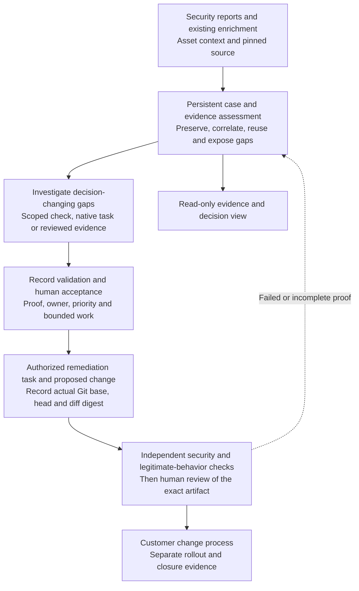

# OpenFix

**Findings to evidence. Evidence to action.** OpenFix 0.2 is a local harness for AI-assisted security workflows. It connects reports and existing enrichment to investigation, validation, customer decisions, bounded remediation and exact-patch review.

The customer problem is the work between a security signal and a defensible change: reconciling what different tools already know, establishing applicability, finding an accountable owner, and deciding whether a proposed fix is safe. OpenFix makes that evidence and decision history portable across tools and agent hosts.

## Walk through the repository

Start with the [repository walkthrough](docs/repository-walkthrough.md). It is a reading path through the value, code, tests and design choices; it requires no running application or prepared playback.

- [AI security and DevSecOps](docs/ai-security-model.md): what AI changes, what mature security programs already do, and the distinction between securing software with AI and securing AI systems.
- [System architecture and detailed Mermaid diagrams](docs/architecture.md): components, trust boundaries, evidence decisions, lifecycle, agent handoffs, data model and production evolution.
- [Editable Excalidraw architecture whiteboards](docs/whiteboards/README.md): three focused views of customer value, trust boundaries and exact-patch approval, with SVG/PNG previews.
- [Input and evidence contracts](docs/input-contracts.md): what crosses a boundary and what authority it carries.
- [Roadmap](ROADMAP.md): the next implementation increments and their acceptance criteria.

## System at a glance



The implemented control flow is local. Native Codex execution happens in a separately approved host; the optional Cursor adapter can publish a draft PR only with explicit authorization. The reference validator covers one invoice-authorization contract, while broader validators and production workers remain future work.

## Why an AI security harness

Mature DevSecOps already includes enrichment, triage, validation, ownership and change control. AI can help investigate unfamiliar source paths, connect context and propose changes across varied cases. That also creates a need to constrain tool access, treat retrieved content as untrusted data, retain uncertainty and verify outputs independently.

OpenFix provides the surrounding harness: persistent case state, evidence contracts, action gates, bounded task packets, failure records and artifact-bound review. It does not embed a model or claim that a model verdict proves a vulnerability or a fix. The [AI security model](docs/ai-security-model.md) explains both the opportunity and the additional evaluation required.

| Customer value hypothesis | Mechanism to inspect in this repository |
| --- | --- |
| Reduce repeated investigation | Preserve producer enrichment and reuse matching, current evidence |
| Improve decision quality | Keep conflicting, stale and inconclusive evidence visible |
| Make agent work reviewable | Carry scope, evidence gaps, allowed actions and expected outputs in a task packet |
| Avoid accepting plausible but harmful fixes | Verify security and legitimate behavior against the exact changed artifact |
| Support controlled adoption | Keep priority, acceptance, execution, publication, review and closure as distinct decisions |

These are pilot hypotheses, not measured customer results. The [pilot worksheet](docs/prep/pilot-worksheet.md) defines effort, accepted outcomes, false fixes, cost and boundary-violation measures.

## What happens to a finding

| Stage | Implemented behavior |
| --- | --- |
| **Import and correlate** | SARIF, GitHub code-scanning alerts, Snyk JSON, Codex Security scan JSON and OpenFix envelopes become scoped cases. Original observations and supplied enrichment remain attributed to their producer. Grouping is an investigation aid, not proof of equivalence. |
| **Assess existing evidence** | Keep producer claims separate from local observations and operator attestations. Check subject revision, age and conflicting values; never promote an imported verdict to independent confirmation. |
| **Enrich the gaps** | Join asset/owner/exposure/deployed-version context by exact identity, inspect source at a clean pinned revision, and inspect dependency versions when lockfile evidence exists. Reuse matching current evidence and make missing or stale signals visible. |
| **Validate and prioritize** | Record confirmed, disproved or inconclusive outcomes. The executable reference profile tests tenant isolation and legitimate access. Other environments can supply explicitly reviewed evidence. Priority explains severity, exposure, business importance and evidence inputs; it does not grant authority. |
| **Plan and remediate** | Accept an owner, rationale and bounded scope. Export a native-agent task packet or explicitly dispatch an eligible case through the optional Cursor adapter. Secrets and infrastructure changes route to their responsible specialist. |
| **Verify and review** | Bind a real Git diff to its base/head and digest. Check the original issue and legitimate behavior at the exact changed head. Missing or failed checks block approval. Patch changes invalidate prior verification and review. |
| **Retain the decision** | Persist cases, evidence, unsuccessful attempts and an audit chain. Rollout and closure record explicit operator attestations; the application does not merge or deploy changes. |

The default `openfix` / `dev` entry points own this workflow and its persistent cases. The original Cursor pipeline remains available through `npm run legacy -- ...` and as an optional executor bridge.

## Bring reports and context

```bash
node src/openfix.mjs import findings.sarif github-alerts.json \
  --repository https://github.com/ORG/APP --revision REAL_COMMIT_SHA \
  --asset-id service:billing --brief customer-brief.json
node src/openfix.mjs enrich all --context asset-context.json
node src/openfix.mjs show CASE_ID
node src/openfix.mjs plan CASE_ID --out /tmp/new-investigation-packet
```

Use the actual repository and revision represented by the report. Unknown revisions stay unresolved. An older-revision enrichment is retained and excluded from current context. A completed or empty later scan never auto-closes an earlier case.

Read [input and evidence contracts](docs/input-contracts.md) for formats and examples, [architecture](docs/architecture.md) for boundaries, and `node src/openfix.mjs help` for the full command surface.

## OpenAI and existing tools

OpenFix follows the public [Defense Factory](https://openai.com/the-defense-factory/) pattern of inventory, discovery/import, validation, ownership and verified remediation. It integrates evidence and decisions around security capabilities rather than claiming to reproduce OpenAI's internal service.

- **Codex Security:** import a SARIF export or the documented `scan --json` wrapper, preserving findings, producer validation and coverage metadata. Repository/revision scope must be explicit when not available in the imported format. No Cloud API or authenticated live Cloud connector is invented.
- **Native Codex workflow:** export a bounded case packet and use the repository's [investigation](.agents/skills/openfix-investigate/SKILL.md) or [remediation](.agents/skills/openfix-remediate/SKILL.md) skill in the customer's approved host. No direct OpenAI API client or new API key is needed by the local orchestration core. Native product access and billing remain separate.
- **Cursor:** `dispatch CASE --engine cursor --execute --publish-draft --actor NAME` can use the existing SDK after case gates pass. This explicitly authorizes creating a draft pull request. Install dependencies and configure the existing Cursor credential first. This adapter was typechecked; no live Cursor job was executed for this release.
- **Promptfoo:** an optional future lane for evaluating agent behavior, including hostile evidence and unauthorized tool use. It is separate from verifying a code fix.
- **Endor Labs Agent Kit:** a [public reference](https://github.com/endorlabs/endor-labs-agent-kit) for task workflows and evidence/output contracts. No Endor API integration is claimed.

## Engineering checks and local fixtures

The core uses Node.js 22.13+ and its standard library. Maintainers can run the checks below; none is needed to follow the repository walkthrough.

```bash
npm install --ignore-scripts
npm test
npm run typecheck
npm run build
npm run demo -- --out /tmp/openfix-workbench.html
```

The fixture workflow retains five source observations across four cases and five attempted validation/verification runs. It includes a reproduced vulnerability, a disproved report, an unavailable validator and conflicting ownership; a deny-all patch fails before the correct patch passes. Inspect the [fixture implementation](src/workflow/demo.mjs), [assertions](tests/workflow.test.mjs) and [maintainer instructions](DEMO.md) as software evidence. These do not establish detection accuracy, model quality or customer ROI.

## Scope and next work

The reference validator is a bounded local process with explicit execution. It is **not** a container or network sandbox; untrusted customer code needs an approved isolated worker. Local actor names and role checks are audit assertions, not enterprise identity or RBAC. Exported native-product evidence is preserved but its authenticity is not independently established by importing JSON. Recognized credential patterns are redacted; source/report handling still requires a suitable data policy.

Production identity, isolated workers, authenticated evidence ingestion, live connector qualification and deployment verification are the next increments in the [roadmap](ROADMAP.md). The [verification record](docs/prep/validation.md) distinguishes tested behavior from those remaining requirements.

The [purple visual reference deck and preparation pack](docs/prep/README.md) support the same repository discussion. A customer working session should follow the supplied problem and constraints; this material is optional reference, not a required presentation.

## License

MIT
