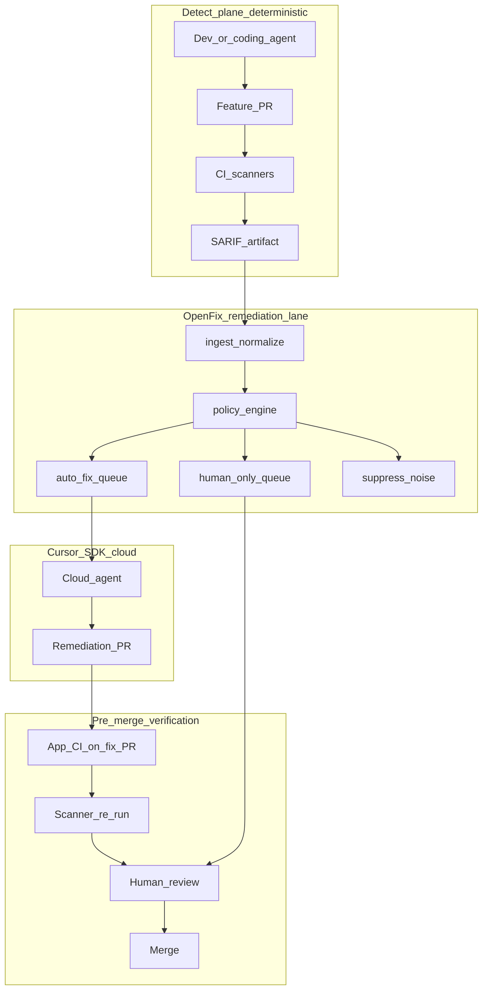

# OpenFix

**Scanner findings in. Cursor agents remediate. PRs out for human review.**

OpenFix is an enterprise SDLC remediation orchestrator built on the [Cursor SDK](https://cursor.com/docs/sdk/typescript). Deterministic security scanners (Snyk, Semgrep, GHAS, Checkmarx, Trivy, …) remain the source of truth for *detection*. Cursor cloud agents propose *remediations* as pull requests. Humans *authorize* merges.

OpenFix is **not** a scanner, **not** an auto-merge bot, and **not** agent self-attestation.

## Why this exists

If coding agents author code *and* self-grade security, assurance is circular. Dedicated scanners are rule-based and auditable; agents are powerful but probabilistic. OpenFix enforces separation of duties:

| Plane | Owner | Mechanism |
| --- | --- | --- |
| Detect | Enterprise scanners in CI / scheduled jobs | SARIF / JSON |
| Remediate | Cursor cloud agents via OpenFix | Fix PRs |
| Authorize | Humans + policy | Review / merge |

## Architecture



## Two GitHub Actions — different jobs

| Workflow | Lives in | Purpose | When you show it |
| --- | --- | --- | --- |
| **OpenFix: SARIF → fix PRs** | This repo (orchestrator) | **Runs OpenFix in CI** — ingest → triage → live Cursor remediate | Architecture: “same code as the CLI, triggered after scanners” |
| **App CI (verify fix PR)** | [openfix-vulnerable-app](https://github.com/markusweldon/openfix-vulnerable-app) | **Tests the agent’s PR** before humans merge | Open a remediation PR → Checks tab |

The impressive live demo is still **CLI → streaming agent → PR**. Actions prove **where it sits in the enterprise SDLC**, not a replacement for watching the agent work.

OpenFix Action is **manual-only** (`workflow_dispatch`) so you don’t get empty/boring automatic runs. Add secrets `CURSOR_API_KEY` + `OPENFIX_TARGET_REPO`, then **Actions → OpenFix: SARIF → fix PRs → Run workflow**.

## Where it sits in the SDLC

| Stage | What happens | OpenFix role |
| --- | --- | --- |
| Create | Dev/agent opens a feature PR | None |
| Detect | CI runs Semgrep/Snyk/CodeQL → SARIF | None (by design) |
| Remediate | Findings exist | **OpenFix (CLI or CI Action) → Cursor → fix PR** |
| Verify | App CI + scanner re-run on the **fix PR** | Agent proposes; checks prove |
| Authorize | Human review + merge | Never auto-merge |

## Pre-merge verification

```bash
npx tsx src/cli.ts verify --pr https://github.com/markusweldon/openfix-vulnerable-app/pull/1
```

1. Agent-local tests in the cloud VM  
2. **App CI** on the fix PR (unit tests)  
3. **Scanner re-run** on the fix PR (detective control — no self-attestation)  
4. Human review of Diff + provenance  
5. Merge  

## Quick start (live)

```bash
cd ~/dev/openfix
npm install
# .env: CURSOR_API_KEY + OPENFIX_TARGET_REPO

npx tsx src/cli.ts ingest fixtures/findings/demo.sarif
npx tsx src/cli.ts triage
npx tsx src/cli.ts remediate              # live cloud agent → PR (highest severity)
npx tsx src/cli.ts remediate --agents 2   # concurrent labeled streams (capped)
npx tsx src/cli.ts status bc-...
npx tsx src/cli.ts resume bc-... --prompt "Address review comments"
npx tsx src/cli.ts verify --pr <url>

# Fleet drain (multiple live agents, up to OPENFIX_MAX_CONCURRENT)
npx tsx src/cli.ts remediate --all-auto
```

## CLI

| Command | Purpose |
| --- | --- |
| `openfix ingest <path>` | Normalize SARIF / findings JSON |
| `openfix triage` | Deterministic policy (no agents) |
| `openfix remediate` | **Live** Cursor cloud agents (`--agents N`, `--all-auto`, `--fingerprint`) |
| `openfix status <agentId>` | Inspect durable agent |
| `openfix resume <agentId> --prompt "..."` | Multi-step follow-up |
| `openfix verify [--pr url]` | Pre-merge checklist |

## Policy

- **`auto_fix`** — High/Medium SCA; SAST with file+line outside sensitive paths  
- **`human_only`** — Critical; auth/secrets/IaC — **not** sent to the bot  
- **`suppress_noise`** — Info/Note; already-remediating fingerprints  

Queue: **highest severity first**. `OPENFIX_MAX_CONCURRENT` (default 2) caps fleet size. Org scale = same lane in each app’s CI (one SARIF per repo).

## Demo script (~15–18 min)

1. Frame + architecture (detect ≠ remediate ≠ authorize; verify before merge).  
2. `ingest` + `triage` (point at `human_only` secret vs bot queue).  
3. **Live** `remediate` — stream agent → open PR.  
4. PR Checks = App CI story; `verify --pr`.  
5. Optional: show OpenFix Action as CI placement of the same orchestrator.  
6. `status` / `resume` for async multi-step.  

## Configuration

See [`.env.example`](.env.example). Never commit `.env` or `.openfix/`.

## Trade-offs

- Fixture SARIF (intentional — vendor-agnostic, reliable demos).  
- OpenFix Action is manual until you wire real scanner artifacts + secrets.  
- Policy is simple on purpose; evolve with SLAs / CODEOWNERS / reachability.

## License

MIT
