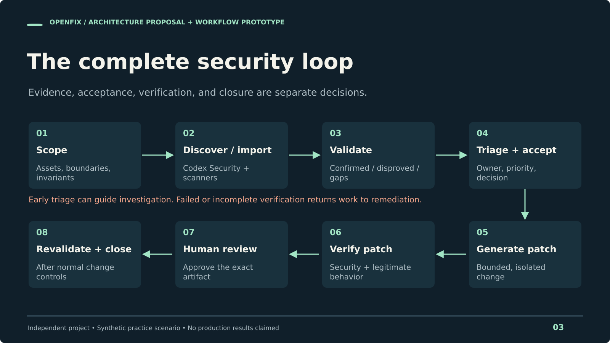
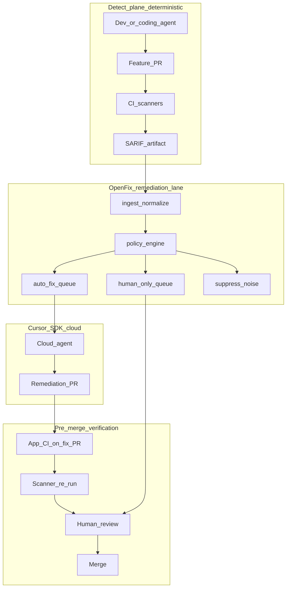

# OpenFix

The [preparation pack](docs/prep/README.md) now includes an editable deck, PDF, speaker notes, workflow and architecture diagrams, a pilot worksheet, and a [full lifecycle refactor proposal](docs/prep/refactor-plan.md).



The current v1 application is the Cursor-based remediation orchestrator described below. A new [lifecycle domain prototype](src/lifecycle/workflow.mjs) models validation, acceptance, patch identity, verification, review, revalidation, and closure; live product integrations and the complete workbench remain proposed.

```bash
npm run test:lifecycle
npm run demo:lifecycle
```

## Current v1 implementation

**Scanner findings in. Cursor agents remediate. PRs out for human review.**

OpenFix is an enterprise SDLC remediation orchestrator built on the [Cursor SDK](https://cursor.com/docs/sdk/typescript). Deterministic security scanners (Snyk, Semgrep, GHAS, Checkmarx, Trivy, …) remain the source of truth for *detection*. Cursor cloud agents propose *remediations* as pull requests. Humans *authorize* merges.

OpenFix is **not** a scanner, **not** an auto-merge bot, and **not** agent self-attestation.

## Why this exists

If coding agents author code *and* self-grade security, assurance is circular. Dedicated scanners are rule-based and auditable; agents are powerful but probabilistic. OpenFix enforces separation of duties:

| Plane | Owner | Mechanism |
| --- | --- | --- |
| Detect | Enterprise scanners in CI / scheduled jobs | SARIF / JSON |
| Remediate | Cursor cloud agents via OpenFix | Fix PRs |
| Authorize | Humans + policy | Review / merge |

## Architecture



## Two GitHub Actions — different jobs

| Workflow | Lives in | Purpose |
| --- | --- | --- |
| **OpenFix: SARIF → fix PRs** | This repo (orchestrator) | Runs OpenFix in CI — ingest → triage → Cursor remediate |
| **CI** (on app repo) | [openfix-vulnerable-app](https://github.com/markusweldon/openfix-vulnerable-app) | PR gates on remediation PRs — Unit tests + Scanner re-run stub |

The live CLI surface is a **finding-lane board** (severity, finding, location, live status) that opens draft fix PRs. The Actions workflows show where the same orchestrator and app gates sit in an enterprise SDLC.

OpenFix Action is **manual-only** (`workflow_dispatch`) by default. Add secret `CURSOR_API_KEY`. In Actions, the target repo and commit default to `github.repository` / `github.sha` (same-repo pipeline). Override with `OPENFIX_TARGET_REPO` / `OPENFIX_COMMIT_SHA` for local CLI or when the job remediates a different repo than the one running the workflow.

### Hosting: Actions is the hook, not the product

You do **not** host agent VMs — Cursor cloud does. You ship OpenFix as an **org reusable workflow / Action** and wire it into each app repo after scanners emit SARIF.

| Layer | Role |
| --- | --- |
| GitHub Action (thin) | Trigger + checkout + run `ingest` → `triage` → `remediate`; pass run context from `GITHUB_*` |
| OpenFix control plane | Policy, Finding normalization, queue, run provenance |
| Cursor cloud agents | Durable remediations (`bc-…`), draft PRs, `status` / `resume` |
| App CI on the fix PR | Unit + scanner re-run — system of record before human merge |

**Enterprise path:** one reusable workflow version → called from every service after detect. Scale = fan-out per app pipeline, not a central mega-orchestrator. This demo’s CLI is the same control plane without the hook; the Action shows production placement.

## Where it sits in the SDLC

| Stage | What happens | OpenFix role |
| --- | --- | --- |
| Create | Dev/agent opens a feature PR | None |
| Detect | CI runs Semgrep/Snyk/CodeQL → SARIF | None (by design) |
| Remediate | Findings exist | **OpenFix (CLI or CI Action) → Cursor → fix PR** |
| Verify | App CI + scanner re-run on the **fix PR** | Agent proposes; checks prove |
| Authorize | Human review + merge | Never auto-merge |

## Pre-merge verification

```bash
npx tsx src/cli.ts verify --pr https://github.com/markusweldon/openfix-vulnerable-app/pull/1
# or: npx tsx src/cli.ts verify --last
```

Prints a compact **App CI** poll for that PR via `gh` (commit check-runs). App workflow **CI** is lean on purpose: **Unit tests** + **Scanner re-run (detective control)** stub. OpenFix does not re-scan — detection stays outside the agent.

Use `verify --checklist` for the full human / branch-protection gate list (opt-in).

1. Agent-local tests in the cloud VM  
2. **Unit tests** on the fix PR  
3. **Scanner re-run** stub on the fix PR (replace with real Semgrep/OSV/CodeQL in production)  
4. Human review of Diff + provenance  
5. Merge  

`verify` exits **1** only if a polled check **failed**. Pending checks stay exit **0** (re-run shortly). Without `--pr`/`--last`, it reminds you how to poll (exit 0).

**Remediate exit codes:** the orchestrator exits non-zero if any agent errors/cancels or finishes without a PR URL — so CI does not go green on a failed remediation.

## Quick start (live)

```bash
cd ~/dev/openfix
npm install
# .env: CURSOR_API_KEY + OPENFIX_TARGET_REPO

npx tsx src/cli.ts ingest fixtures/findings/demo.sarif
# Multi-artifact: merge + fingerprint dedupe
# npx tsx src/cli.ts ingest fixtures/findings/demo.sarif fixtures/findings/extra.json
# or: npx tsx src/cli.ts ingest --from simulated:semgrep   # MCP-style adapter stub
npx tsx src/cli.ts triage
npx tsx src/cli.ts remediate              # finding-lane board → draft PR
npx tsx src/cli.ts remediate --agents 2   # concurrent lanes (capped); Fleet table lists each bc-…
npx tsx src/cli.ts remediate -n 2 --verbose  # full agent stream (debug)
npx tsx src/cli.ts status bc-...
npx tsx src/cli.ts resume bc-... --prompt "Address review comments"
npx tsx src/cli.ts verify --pr <url>

# Fleet drain (multiple live agents, up to OPENFIX_MAX_CONCURRENT)
npx tsx src/cli.ts remediate --all-auto
```

Default `remediate` paints a live board (`SEV | FINDING | LOCATION | STATUS`) with in-place status and a spinner while agents run. During `running`, STATUS may show a short snippet from the agent stream (progress hint); use `--verbose` for the full transcript. After the run, **── Fleet ──** lists each lane’s `bc-…` agent id (use that for `status` / `resume`, not only `--last`). Run id / repo / commit SHA appear on **`ingest`** and **`triage`**, not on the board (persisted under `.openfix/`).

## CLI

| Command | Purpose |
| --- | --- |
| `openfix ingest <path> [path…]` | Normalize SARIF / findings JSON (multi-file merge + fingerprint dedupe); writes run context |
| `openfix ingest --from simulated:semgrep` | Simulated MCP-style adapter → same Finding[] (demo only) |
| `openfix triage` | Deterministic policy (no agents) |
| `openfix remediate` | Cursor cloud agents (`--agents N`, `--all-auto`, `--fingerprint`, `--verbose`); fails if agent ≠error`/`cancelled` or no PR |
| `openfix status <agentId>` | Inspect durable agent |
| `openfix resume <agentId> --prompt "..."` | Multi-step follow-up |
| `openfix verify [--pr url]` | Poll App CI on the fix PR (`--last`, `--checklist`) |

## Policy

- **`auto_fix`** — High/Medium SCA; SAST with file+line outside sensitive paths  
- **`human_only`** — Critical; auth/secrets/IaC — **not** sent to the bot  
- **`suppress_noise`** — Info/Note; already-remediating fingerprints  

Queue: **highest severity first**. `OPENFIX_MAX_CONCURRENT` (default 2) caps fleet size. Org scale = same lane in each app’s CI (one SARIF per repo).

## Demo script (~15–18 min)

1. Frame + architecture (detect ≠ remediate ≠ authorize; verify before merge).  
2. `ingest` + `triage` (point at `human_only` secret vs bot queue).  
3. **Live** `remediate` / `remediate --agents 2` — finding-lane board → draft PRs.  
4. PR Checks = App CI (unit + scanner stub); `verify --pr` / `--last`.  
5. Optional: OpenFix Action as CI placement of the same orchestrator.  
6. `status` / `resume` for async multi-step.  

## Configuration

See [`.env.example`](.env.example). Never commit `.env` or `.openfix/`.

- **Local CLI:** set `OPENFIX_TARGET_REPO` (+ optional `OPENFIX_COMMIT_SHA`).
- **GitHub Actions (same-repo lane):** omit target repo — derived from `GITHUB_REPOSITORY` / `GITHUB_SHA`; each ingest writes `.openfix/runs/<id>.json` run context.

## Trade-offs

- Fixture SARIF (intentional — vendor-agnostic, reliable demos).  
- OpenFix Action is manual until you wire real scanner artifacts + secrets.  
- Policy is simple on purpose; evolve with SLAs / CODEOWNERS / reachability.  
- App CI scanner job is a stub in the demo app; swap in real tools for production.

## License

MIT

