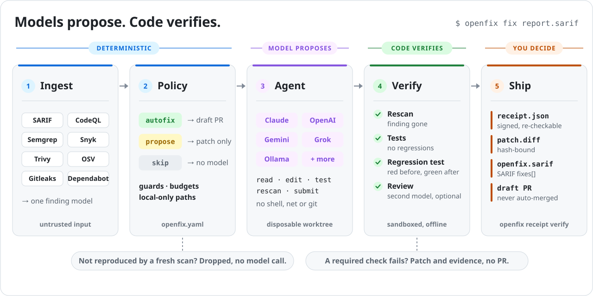

<div align="center">

<picture>
  <source media="(prefers-color-scheme: dark)" srcset="docs/assets/logo-dark.svg">
  
</picture>

**Turn scanner findings into verified fixes, with any model, under your policy.**

[](https://github.com/markusweldon/openfix/actions/workflows/ci.yml) [](pyproject.toml) [](LICENSE) [](ROADMAP.md)

[Quick start](#quick-start) · [How it works](#how-it-works) · [Policy](#policy-as-code) · [Models](#bring-any-model) · [GitHub Action](#github-action) · [Docs](#documentation)

</div>

---

OpenFix reads the reports your scanners already produce: Semgrep, CodeQL, Snyk, Trivy, OSV-Scanner, Gitleaks, Dependabot, or anything that writes SARIF. A policy file decides which findings may be fixed. The model you choose writes a minimal patch in a throwaway checkout, and OpenFix then **checks the patch without trusting the model**. A fix only counts when the scanner, your tests and a new regression test all agree.

Every fix comes with a **receipt**: a signed, re-checkable record of what changed, why it was allowed, which model wrote it and what proved it works.

<br>

<picture>
  <source media="(prefers-color-scheme: dark)" srcset="docs/assets/architecture-dark.svg">
  
</picture>

<br>

## Why OpenFix

<table>
<tr>
<td width="50%" valign="top">

### 🔌 Any model
Claude, OpenAI, Gemini, Grok, OpenRouter, Groq, DeepSeek, Mistral, Together, Fireworks, any OpenAI-compatible gateway, or a local model through Ollama, vLLM or LM Studio. Change it with one flag: `--model provider:model`.

</td>
<td width="50%" valign="top">

### ✅ Proof, not prose
Verification is a separate step. It never asks the model whether the fix worked. Findings that a fresh scan can't reproduce are dropped **before** any model is called, so stale results cost nothing.

</td>
</tr>
<tr>
<td valign="top">

### 📜 Policy as code
One YAML file decides what is auto-fixed, what only gets a proposed patch, and what is never sent to a model. It also sets change-size limits, protected paths, budgets, and which code may only be seen by local models.

</td>
<td valign="top">

### 🧱 A small blast radius
The agent has no shell, no network and no git. It can read, search and edit files, run your tests and re-run the scanner, and every write is checked against the policy. Tests run in a Docker container with networking off.

</td>
</tr>
<tr>
<td valign="top">

### ⚙️ Deterministic when it can be
A vulnerable direct dependency is bumped to the lowest fixed version with no model involved. That is cheaper, faster and reproducible.

</td>
<td valign="top">

### 🧾 Fits your pipeline
CLI and GitHub Action. SARIF in and SARIF out (with `fixes[]`). in-toto receipts with optional Sigstore signing. Draft PRs for humans to review. It never merges anything.

</td>
</tr>
</table>

## Quick start

```bash
pip install "openfix[all] @ git+https://github.com/markusweldon/openfix"
export ANTHROPIC_API_KEY=...          # or OPENAI_API_KEY, GEMINI_API_KEY, XAI_API_KEY, ... (openfix providers)

semgrep scan --sarif -o semgrep.sarif # any scanner that writes SARIF or a supported JSON format
openfix plan semgrep.sarif            # what the policy will do with each finding; no model calls
openfix fix  semgrep.sarif            # fix, verify, and write receipts to .openfix/runs/<timestamp>/
```

Use a different model to write fixes than the one that reviews them, and open draft PRs for the fixes that pass:

```bash
openfix fix semgrep.sarif --model openai:gpt-5 --reviewer anthropic:claude-opus-5-5 --open-prs
```

<details>
<summary><b>Try it without an API key</b></summary>

<br>

The repository includes a deliberately vulnerable Node app, real Semgrep rules, and a recorded model session:

```bash
git clone https://github.com/markusweldon/openfix && cd openfix
pip install -e . semgrep
cd examples/vulnerable-app
openfix fix findings/semgrep.sarif --only path-traversal-path-join-var \
  --model scripted:demo/path-traversal.script.yaml --sandbox local
```

```text
→ [high] path-traversal-path-join-var src/files.js:11  [autofix via rule 'code findings']
  verified: all required checks passed (rescan, tests, regression_test)
```

CI runs this same flow on every push.

</details>

## How it works

| # | Stage | What happens |
|:-:|---|---|
| 1 | **Ingest** | Reports are detected and normalized into one finding model. Secret values are redacted and finding ids are sanitized, because reports are untrusted input. |
| 2 | **Policy** | The first matching rule in `openfix.yaml` decides `autofix`, `propose` or `skip`, and guards and budgets are applied. |
| 3 | **Reproduce** | A fresh scan of the original code must still report the finding. If it doesn't, the finding is dropped. |
| 4 | **Fix** | The model works in a disposable git worktree through a small set of policy-checked tools. Your checkout is never touched. |
| 5 | **Verify** | The checks below run independently of the agent. |
| 6 | **Ship** | OpenFix writes `patch.diff`, `receipt.json` and SARIF `fixes[]`. A verified `autofix` can become a draft PR. |

### The checks

| Check | What it proves |
|---|---|
| **Rescan** | The scanner reports the finding on the original code, **and** doesn't report it (or anything new) on the patched code. |
| **Tests** | Your test suite does no worse on the patched code than on the original. |
| **Regression test** | The test the agent added **fails on the original code and passes with the fix**, so it actually exercises the vulnerability. |
| **Review** *(optional)* | A second model, ideally from another provider, reads the exact diff, looking for bypasses and behavior changes. |

### The receipt

Each receipt is an [in-toto](https://in-toto.io) statement whose subject is the SHA-256 of `patch.diff`. It records the finding, the policy decision, the model and token cost, and the evidence for every check. Sign it with `--sign` (Sigstore cosign), and re-check it at any time:

```bash
openfix receipt verify .openfix/runs/<timestamp>/<finding-id> --repo .
```

## Policy as code

```yaml
# openfix.yaml (the first matching rule wins)
rules:
  - match: { category: [secrets] }
    action: skip                       # rotate credentials; don't just delete them from code
  - match: { path: ["**/auth/**", "**/payment*/**"] }
    action: propose                    # patch + receipt for a human, no PR
  - match: { category: [sast, sca], min_severity: medium }
    action: autofix                    # draft PR when every required check passes
guards:
  max_files_changed: 4
  max_lines_changed: 200
  protected_paths: [".github/workflows/**", "**/.env*"]
models:
  author: anthropic:claude-opus-5-5
  reviewer: openai:gpt-5
  local_only_paths: ["services/payments/**"]   # this code is only ever sent to local models
budgets: { max_turns: 40, max_usd_per_fix: 3.0, max_usd_per_run: 25.0 }
verify:
  require: [rescan, tests, regression_test]
```

Run `openfix init` to write a starter file. Full reference: [docs/policy.md](docs/policy.md).

## Bring any model

| Provider | Example `--model` | Credential |
|---|---|---|
| Anthropic | `anthropic:claude-opus-5-5` | `ANTHROPIC_API_KEY` |
| OpenAI | `openai:gpt-5` | `OPENAI_API_KEY` |
| Google Gemini | `gemini:gemini-2.5-pro` | `GEMINI_API_KEY` |
| xAI Grok | `xai:grok-4` | `XAI_API_KEY` |
| OpenRouter, Groq, DeepSeek, Mistral, Together, Fireworks | `openrouter:<model>`, `groq:<model>`, … | `<PROVIDER>_API_KEY` |
| Any OpenAI-compatible gateway | `compat:<model>` | `OPENFIX_COMPAT_BASE_URL` |
| Local: Ollama, vLLM, LM Studio | `ollama:qwen2.5-coder:32b` | none |

Run `openfix providers` to see which credentials are set. Details: [docs/providers.md](docs/providers.md).

## GitHub Action

```yaml
name: OpenFix
on:
  workflow_dispatch:
  schedule: [{ cron: "0 6 * * 1" }]
permissions:
  contents: write
  pull-requests: write
jobs:
  fix:
    runs-on: ubuntu-latest
    steps:
      - uses: actions/checkout@v4
      - run: pip install semgrep && semgrep scan --config p/default --sarif -o semgrep.sarif || true
      - uses: markusweldon/openfix@v0.3.0
        with:
          reports: semgrep.sarif
          model: anthropic:claude-opus-5-5
          reviewer: openai:gpt-5
        env:
          ANTHROPIC_API_KEY: ${{ secrets.ANTHROPIC_API_KEY }}
          OPENAI_API_KEY: ${{ secrets.OPENAI_API_KEY }}
          GITHUB_TOKEN: ${{ secrets.GITHUB_TOKEN }}
```

Each verified autofix becomes a draft PR with an evidence table and the receipt digest. Receipts, `summary.md` and `openfix.sarif` are uploaded as a workflow artifact. Your CI still runs on the PR, and a person still merges it.

## Supported inputs

| Format | Sources |
|---|---|
| SARIF 2.1.0 | Semgrep, CodeQL, Snyk Code, Trivy, Checkov, Bandit, Gitleaks, … |
| Native JSON | Semgrep, Snyk Open Source, Trivy (vulnerabilities, misconfigurations, secrets), OSV-Scanner, Gitleaks |
| GitHub APIs | Code-scanning alerts, Dependabot alerts |
| OpenFix | [Findings JSON](docs/findings-format.md), for your own tools |

Formats are detected automatically. Pass several reports at once and duplicate findings are merged.

## Commands

| Command | |
|---|---|
| `openfix findings REPORT...` | Normalize and list findings (`--json` for OpenFix findings JSON) |
| `openfix plan REPORT...` | Show the policy decision for each finding |
| `openfix fix REPORT...` | Fix, verify and write receipts: `--model`, `--reviewer`, `--only`, `--max`, `--require`, `--sandbox`, `--open-prs`, `--sign` |
| `openfix receipt verify DIR` | Re-check a receipt's digests and that its patch still applies |
| `openfix providers` | Supported providers and credential status |
| `openfix init` | Write a starter `openfix.yaml` |

`--repo` can point at a subdirectory of a monorepo. Findings, tests and scans are resolved relative to it, and patches are written relative to the repository root.

## Documentation

- [Policy reference](docs/policy.md)
- [Providers and models](docs/providers.md)
- [Verification and receipts](docs/receipts.md)
- [Security model](docs/security-model.md): what OpenFix protects against, and what it doesn't
- [Findings format](docs/findings-format.md)
- [Roadmap](ROADMAP.md)

## Status

OpenFix 0.3 is **alpha**. The core pipeline (ingest, policy, agent, verification, receipts and PRs) is implemented and tested end to end against real scanners and test suites. Next on the [roadmap](ROADMAP.md): a public fix-rate benchmark across models, an MCP server, and GitLab support.

Issues and pull requests are welcome; start with [CONTRIBUTING.md](CONTRIBUTING.md). To report a vulnerability in OpenFix itself, see [SECURITY.md](SECURITY.md).

## License

[MIT](LICENSE)
