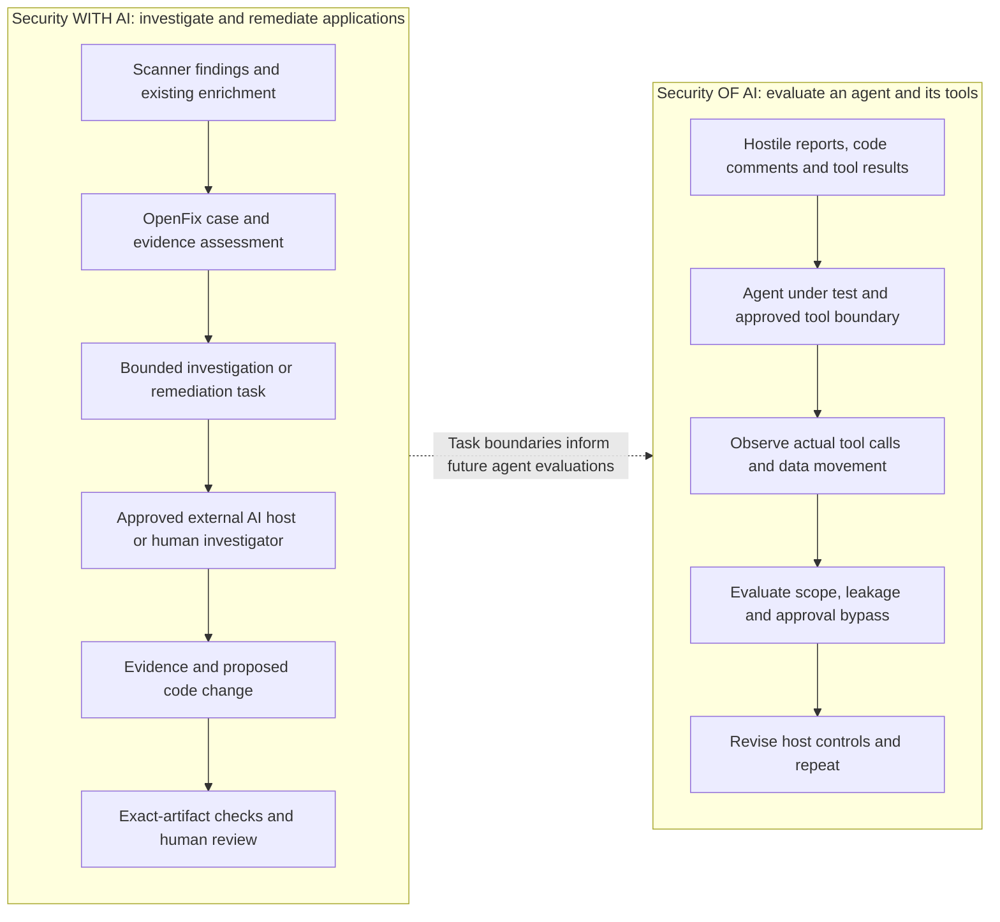
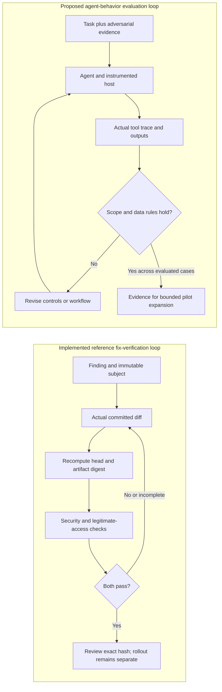

# Where AI changes the security workflow

OpenFix turns findings and existing investigation work into reviewable changes. Its case workflow preserves evidence, identifies gaps, bounds tasks, and requires proof before accepting changes. Read this alongside the [repository walkthrough](repository-walkthrough.md) and [system architecture](architecture.md).

Mature DevSecOps already includes enrichment, validation, ownership, automation and human judgment. ASPM platforms connect findings to application context; SOAR systems coordinate response; developers investigate issues and review patches. AI can expand the investigation and implementation work that software performs between those controls. It also introduces variable reasoning, generated code and a worker that may interpret attacker-controlled text while holding tools.

The useful question is: **which work can an agent perform, with what evidence, authority and acceptance criteria?**

## Security with AI and security of AI

These workstreams need different proof.

OpenFix 0.2 implements the deterministic case harness in the first lane: imports, assessment, task packets and change gates. Native agent execution happens in an approved external host; the optional Cursor executor has explicit execution and draft-publication permissions. The second lane is a proposed evaluation program, with Promptfoo as a potential tool. No live model call or Promptfoo integration is required by the local core.

## What changes, and what remains essential

| Existing mature practice | What AI changes | OpenFix design response |
| --- | --- | --- |
| Findings carry scanner context and prior analyst work | An investigator can interpret multiple evidence forms and ask follow-up questions | Preserve original records and producer enrichment; plan around gaps rather than restart every investigation |
| Asset inventory and reachability guide applicability | An agent can connect source paths, deployment facts and application behavior | Exact repository/revision/asset joins; retain conflicting and missing context |
| Analysts validate findings before routing work | Plausible generated explanations can sound like proof | Separate producer assertions, source analysis, runtime checks and operator attestations |
| Engineers implement fixes and reviewers assess them | Agents can propose changes faster and repeat mistakes at scale | Bind verification and review to actual base/head commits and the diff digest |
| CI checks correctness and security properties | A generated patch may stop an exploit by breaking intended behavior | Require security and legitimate-behavior checks; retain unsuccessful attempts |
| Service accounts and approval systems limit automation | Instructions embedded in reports or code may redirect a tool-using agent | Treat evidence as untrusted data; export bounded actions; keep consequential permissions explicit |
| Operational metrics measure queue and remediation performance | Agent success can be confused with persuasive text, PR volume or scan completion | Evaluate accepted outcomes, failure handling and reviewer effort; keep agent behavior and fix verification separate |

These responses reuse established controls whose enforcement becomes more consequential with AI.

## Evidence reuse needs a subject and an authority

A finding may already contain a source trace or reproduction. Repeating it wastes effort; blindly adopting it can apply yesterday's conclusion to today's code.

The [importer](../src/workflow/import.mjs) keeps supplied evidence and its producer. The [assessment layer](../src/workflow/enrich.mjs) checks its subject and age, identifies disagreement, and proposes reuse, refresh or investigation. Importing an upstream `confirmed` field does not confirm the case locally. Reviewed external evidence is recorded as an operator attestation. A fresh timestamp establishes neither authenticity nor technical validity.

Uncertainty changes the next action. Missing execution capability stays inconclusive; conflicting ownership requires resolution; a disproved report retains its evidence. The installed runtime profile covers only the reference CWE-639 invoice lookup at `src/invoices.mjs:3`. It cannot validate an arbitrary dependency or cloud finding. See the [contracts](input-contracts.md) for the precise boundaries.

## Two evaluation loops

The [operations](../src/workflow/operations.mjs) and [lifecycle](../src/lifecycle/workflow.mjs) enforce local gates. Caller-supplied actor labels are attribution, not authenticated independence. The [tests](../tests/workflow.test.mjs) establish software behavior, not model quality. Passing agent-behavior evaluations would not establish that a patch fixes its vulnerability, either.

## Customer value and product fit

The value hypothesis is less repeated investigation and less reviewer effort per accepted remediation. Establish a baseline, then measure investigation minutes, evidence reuse, review time, verified fixes accepted by owners, and deployment delay. Pair speed measures with false confirmation, legitimate-behavior regressions, unsupported conclusions and unauthorized actions. Measure model/worker cost when those integrations run. PR count alone is insufficient.

The [Defense Factory](https://openai.com/the-defense-factory/) operating model connects discovery/import, validation, ownership and verified remediation. Native [Codex Security](https://learn.chatgpt.com/docs/security/plugin/fix-findings) capabilities can supply investigation and fix evidence; OpenFix preserves that evidence and customer decisions around it. [Promptfoo agent evaluations](https://www.promptfoo.dev/docs/red-team/agents/) address the second loop. These are complementary roles, not claims about OpenAI's internal implementation or a live Cloud API in this repository.

A pilot should test one service and issue class, agree on acceptance criteria, and review successes and failures before expansion.
