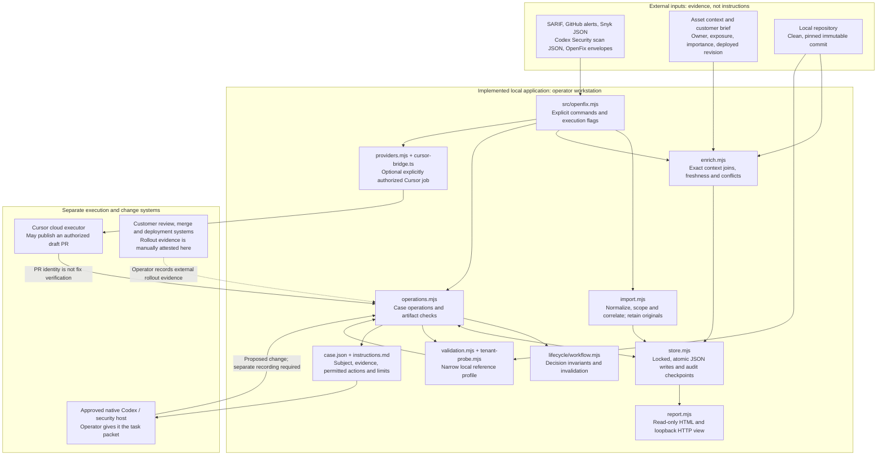
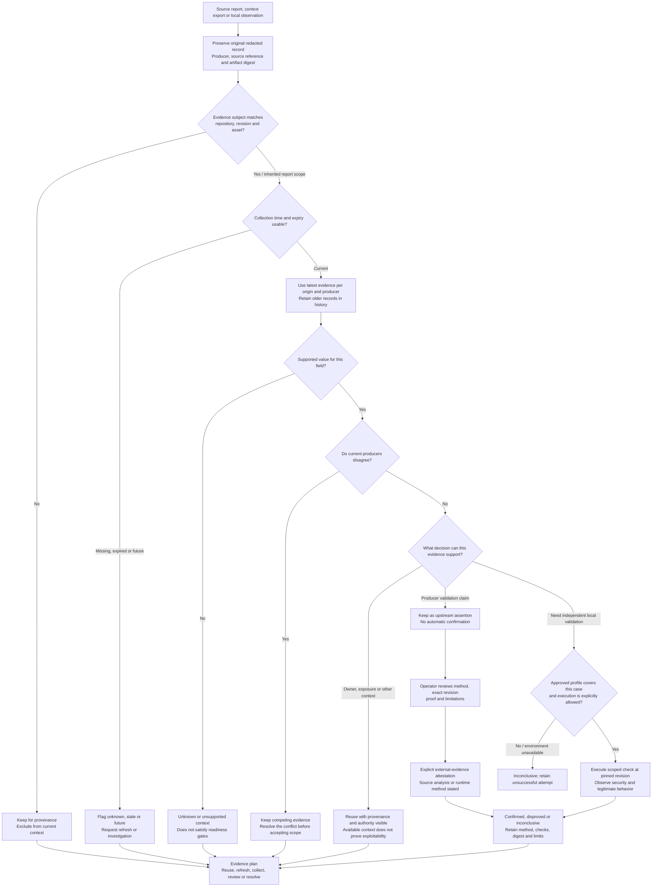
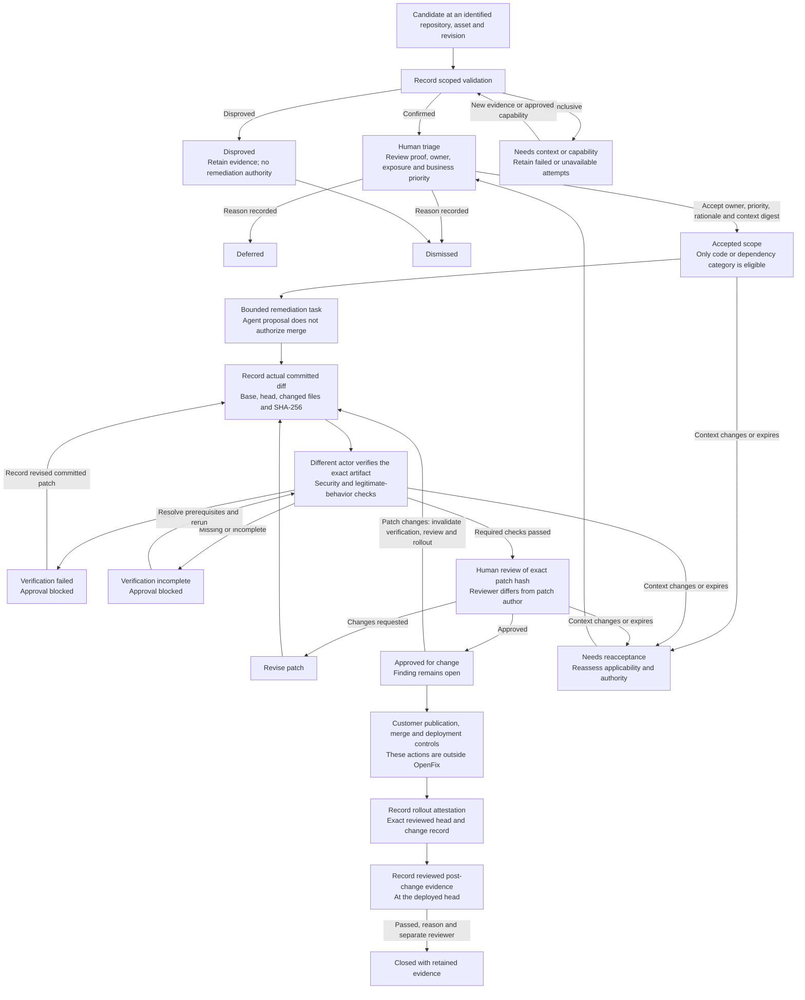
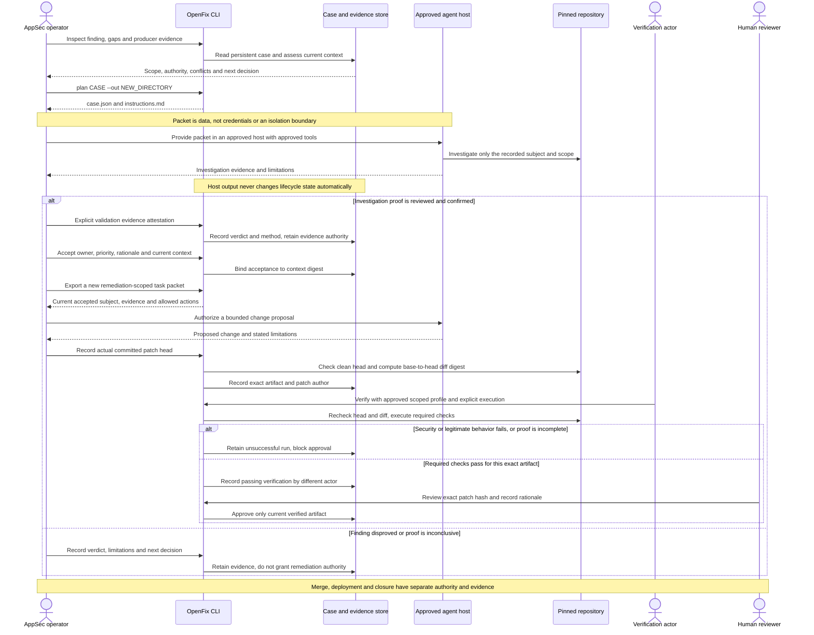
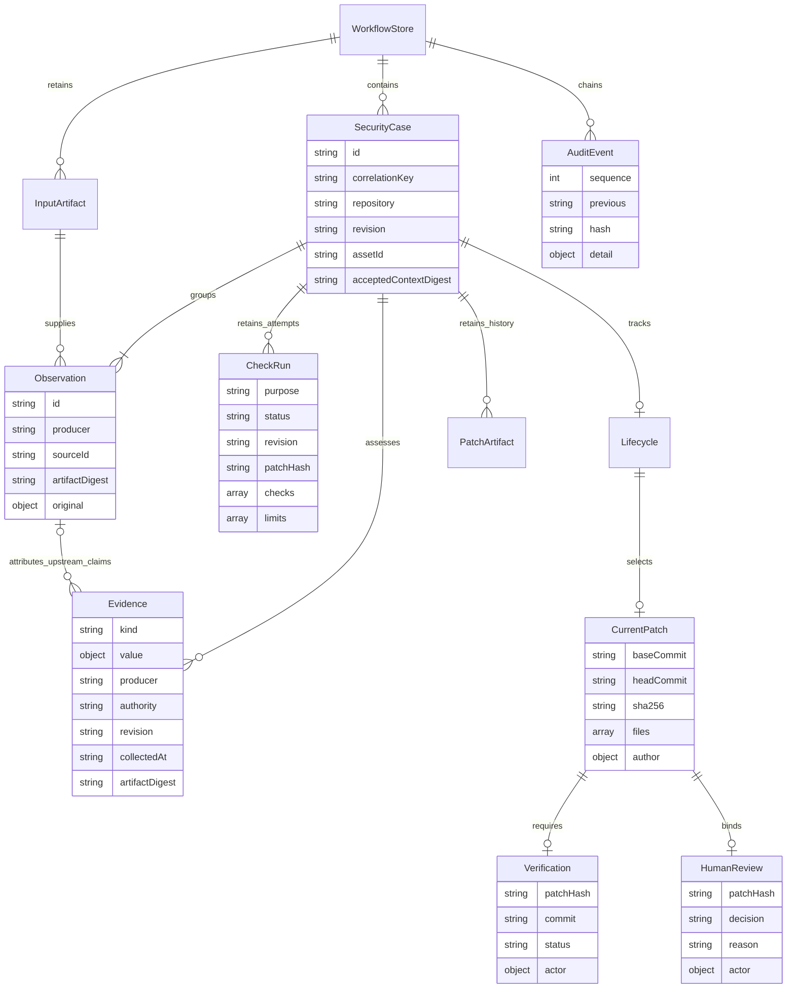
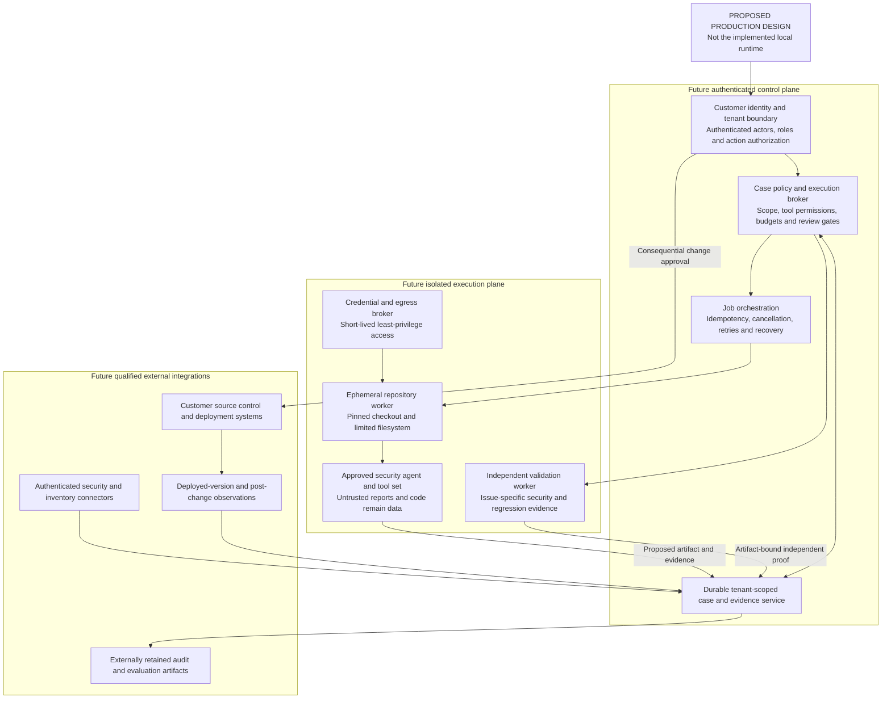

# OpenFix architecture: evidence, authority and verified change

OpenFix is a local orchestration layer around security findings, customer context and change decisions. Its value is the continuity between a reported issue, the evidence supporting it, the action a person authorizes, and the exact artifact that passes verification. The diagrams below are a reading aid for a repository conversation; they require no running application or recorded demonstration.

The core design question is: **when an AI system can investigate and propose changes, what evidence and authority must travel with its work?** Existing scanners, source control, CI and deployment controls still matter. OpenFix makes their observations and decisions usable across an investigation rather than treating an agent's answer or a successful job as proof of remediation.

Read the first four diagrams in order for the system story. The data model explains how that story persists; the last diagram separates the production destination from the local implementation. Every diagram has an editable Mermaid source in [diagrams/](diagrams/).

## 1. Implemented components and trust boundaries

[Mermaid source](diagrams/system-components.mmd)

**Why this shape.** Source adapters and executors change more often than the evidence and decision rules. The default [CLI](../src/openfix.mjs) therefore composes small workflow modules around one persistent case store. A SARIF export, an existing enriched finding, and an agent-generated report can enter the same investigation without discarding their producer-specific evidence.

The report/HTML surface reads state; explicit CLI operations change it. A proposed patch returns through artifact recording and verification. The local workflow core has no direct OpenAI API client. Native Codex/security execution happens in a separately approved host using an exported packet; [Cursor](../src/workflow/providers.mjs) is the optional live executor bridge, with explicit execution and draft-publication authorization.

**Tradeoff.** A local JSON store keeps the design inspectable and inexpensive to run, but it is not a multi-tenant service. The workstation boundary is not a sandbox. Product-specific authentication, isolated customer-code workers and enterprise identity enforcement are separate production work.

**Where to read:** [import adapters](../src/workflow/import.mjs), [enrichment and assessment](../src/workflow/enrich.mjs), [case operations](../src/workflow/operations.mjs), [storage](../src/workflow/store.mjs), [read-only report](../src/workflow/report.mjs).

## 2. Evidence is assessed before it becomes a decision

[Mermaid source](diagrams/evidence-decisions.mmd)

**Why this shape.** A finding may already include reachability analysis, ownership, source traces or runtime proof. Repeating all of that wastes effort; blindly trusting it can apply yesterday's evidence to today's code. [Assessment](../src/workflow/enrich.mjs) preserves the source, identifies evidence that applies to the current subject, and produces an explicit reuse/refresh/collect/resolve plan.

Repository, immutable source revision and asset identity define the case subject. Context manifests join on all three. Each evidence item keeps its own timestamp, expiration and subject; when an input omits those fields, the importer can inherit the report's declared scope. That inherited scope is an operator/producer assertion, not authenticated proof. Evidence explicitly scoped to another subject is retained and excluded from current assessment. Unknown report scope cannot acquire remediation authority.

Freshness defaults to seven days unless an expiration is supplied. Current, supported context can be reused with its authority displayed; conflicting current producers remain a conflict. The implementation takes the latest evidence per producer/origin for an assessment and retains history. These are reference policies to tune with a customer, not universal security truths.

**A crucial distinction:** available context and a producer's `validation: confirmed` field do not independently establish exploitability. An operator can explicitly attest reviewed source or runtime evidence, retaining that authority label. The installed executable profile covers only CWE-639 at `src/invoices.mjs:3`; it is not a general validator. Missing capability, scope mismatch or runtime failure stays inconclusive. Static/source evidence may support a decision, but it must not be described as a runtime reproduction.

**Tradeoff.** The system leaves uncertainty visible, which can slow a single-case path. It prevents a busy pipeline, an old scan or a convincing model response from being mistaken for current proof. Producer scan completion and deferred coverage also remain separate facts.

**Where to read:** [claim extraction and correlation](../src/workflow/import.mjs), [subject/freshness/conflict assessment](../src/workflow/enrich.mjs), [profile and verdict rules](../src/workflow/validation.mjs), [input contracts](input-contracts.md).

## 3. The lifecycle includes failure, changing context and invalidation

[Mermaid source](diagrams/case-lifecycle.mmd)

**Why this shape.** An agent may be useful even when it cannot complete a fix. A disproved candidate, an unavailable environment, a rejected patch and a reviewer asking for changes are meaningful outcomes. The workflow preserves them instead of collapsing everything into success or failure of a single automation job.

Acceptance requires a confirmed finding at the source revision, available current owner/exposure context, a named owner, priority and a reason. Code/dependency categories can enter the supported remediation path; secrets and infrastructure changes route to their responsible specialists. Suggested priority selects attention; it does not grant execution authority.

Acceptance binds a digest of assessed context and the customer brief. If that context changes or ages out, the assessment exposes `needs_reacceptance`; patching, verification and review check current acceptance where applicable. A renewed acceptance clears the previous patch decisions, so the artifact must be recorded and checked again.

A new patch records the actual Git base/head, changed paths and diff digest. It invalidates previous verification, approval and rollout evidence. Verification tests both the security property and legitimate behavior: a change that denies all invoice requests blocks the attack but breaks the product, so it fails. Approval is bound to the exact hash and requires a different actor label from the patch author.

**Tradeoff.** These gates require more explicit decisions than an automatic finding-to-PR pipeline. They make it possible to explain why a change was allowed and what must be revisited after the evidence or artifact changes. Actor-label separation is implemented locally; authenticating independent people and workers requires a production identity system.

Approval leaves the finding open. The CLI does not merge or deploy. Rollout and post-change closure are recorded operator attestations tied to the reviewed revision; they are not independently collected production observations. A later empty scan never closes the case automatically.

**Where to read:** [lifecycle invariants](../src/lifecycle/workflow.mjs), [persistent case operations](../src/workflow/operations.mjs), [lifecycle tests](../tests/lifecycle.test.mjs), [workflow tests](../tests/workflow.test.mjs).

## 4. Agent work crosses an explicit handoff boundary

[Mermaid source](diagrams/agent-handoff-sequence.mmd)

**Why this shape.** The model is a reasoning and proposal capability inside a larger system. It can examine a scoped case and return evidence or a candidate fix, while deterministic code continues to check prerequisites and artifact identity. Returning an answer does not update validation, acceptance, verification or review automatically.

`plan` exports `case.json` and `instructions.md`. The packet contains the subject, source observations, evidence, customer brief, limitations and expected output. Before acceptance its task is investigation; once case gates permit remediation it can request a bounded proposal. Repository text, findings and tool results remain untrusted data. The native [investigation skill](../.agents/skills/openfix-investigate/SKILL.md) and [remediation skill](../.agents/skills/openfix-remediate/SKILL.md) carry those instructions into an approved host.

The sequence shows the portable native-host path. The optional Cursor bridge instead starts a job from an eligible case using `--execute --publish-draft --actor`; this explicitly authorizes a draft PR, which still requires separate exact-artifact verification and review. There is no live Codex Cloud API connector in this implementation and no automatic native-host round trip.

**Tradeoff.** The portable packet avoids coupling the core to one model provider or product's changing execution contract. It also means product authorization, job isolation and trusted result ingestion must be supplied by the execution host. Instructions are not an enforcement boundary. Likewise, the reference verifier is a bounded local process, not an independent network/container sandbox, and only supports the documented invoice subject and invoice-file changes.

**Where to read:** [task packet, patch recording and review](../src/workflow/operations.mjs), [provider capabilities](../src/workflow/providers.mjs), [Cursor bridge](../src/workflow/cursor-bridge.ts), [reference validation](../src/workflow/validation.mjs).

## 5. Data persists as a case with evidence and decision history

[Mermaid source](diagrams/case-data-model.mmd)

This is the conceptual structure of the JSON store, not a relational schema or a deployed database. Lifecycle decisions and current patch objects are nested in their case; original patch artifacts, checks and observations remain available as history. Context evidence added locally need not have an upstream observation. `artifactDigest` can identify input bytes or locally inspected content; it does not always refer to a registered `InputArtifact` object.

**Why this shape.** Correlation groups observations for investigation without deleting their source identities or claiming proven equivalence. A case can show two scanners that agree about a code location, two owners that disagree, and a local validation attempt that failed to run. Reviewers can inspect that history rather than relying on the latest status string.

Writes use an exclusive cross-process lock, fsync and atomic rename. The audit chain and state checkpoint detect corruption and unsynchronized local edits. They do not authenticate an external report or prevent an administrator who controls the files from recomputing hashes. Retaining originals also has a data-handling cost: source/vulnerability records need approved access, storage and retention; recognized secret-pattern redaction is not comprehensive data-loss prevention.

**Where to read:** [case creation](../src/workflow/import.mjs), [evidence records](../src/workflow/enrich.mjs), [store schema and integrity checks](../src/workflow/store.mjs).

## 6. A production evolution, separately scoped

[Mermaid source](diagrams/production-evolution.mmd)

**This diagram is proposed work.** None of the authenticated service, isolated execution plane, credential broker, live runtime connector or externally retained audit service above is implemented by the local CLI.

**Why this destination.** Once an AI system can choose tools or propose changes to customer code, identity, least privilege, data handling, execution isolation and recovery become part of the product. The useful separation is between the control plane deciding permitted work and the execution plane handling untrusted source and tools. An independent verification path should consume the exact proposed artifact, and production closure should consume evidence from the deployed system.

**Tradeoff.** This architecture has operational and integration costs that a local pilot does not. Start with one customer workflow, one issue class and an accountable reviewer. Qualify evidence origin, host isolation, failure handling and evaluation before expanding permissions or issue coverage. The local reference proves inspectable workflow behavior; it does not establish model accuracy, customer ROI or production readiness.

This direction is informed by the public [Defense Factory operating model](https://openai.com/the-defense-factory/) and documented [Codex Security finding/fix workflow](https://learn.chatgpt.com/docs/security/plugin/fix-findings). It is an independent design discussion, not a claim about OpenAI's private implementation. See the [roadmap](../ROADMAP.md) for the increments still to build.
