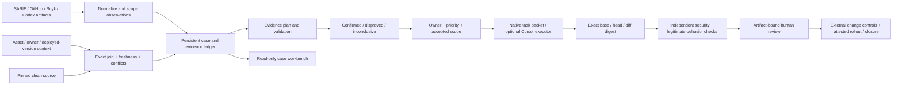

# OpenFix 0.2 architecture

The primary runtime is `src/openfix.mjs`. Its workflow modules use Node's standard library; the optional Cursor bridge reuses the original TypeScript SDK adapter.

## Evidence rather than overwritten fields

An observation retains its producer, original redacted record, input digest and subject. Extracted upstream enrichment is explicitly an assertion. Local source/lockfile observations, executed profile results and operator attestations carry different authority labels. Evidence has independent subject revision and age; importing it never silently upgrades either.

Correlation uses the same repository, immutable revision, asset and issue identity, with exact code file/line for code findings. It groups observations for investigation and keeps all source records. It does not claim a proven duplicate relationship. Unknown scopes stay separate. An empty later report does not resolve prior cases.

Enrichment joins asset data only at exact asset/repository/revision identity. Available context is not proof of exploitability. Conflicting current sources remain a conflict; old or undated evidence cannot satisfy current context gates. Evidence from a different subject is retained but excluded from the current assessment.

## Decisions and artifacts

The lifecycle domain is now used by the actual CLI and persistent store. A candidate cannot authorize a fix by importing a producer verdict. Acceptance records the accountable owner, rationale, priority and current context digest. Changed or expired context requires acceptance again.

A patch is an actual Git diff from the finding revision to a clean immutable head. Verification recomputes the artifact digest and runs explicit security/legitimate-behavior checks at that head. Failed, missing and incomplete checks cannot approve. A different patch invalidates prior verification, review and rollout. Priority remains separate from execution authority.

## Runtime and trust limits

The tenant-isolation validator is a trusted reference probe in a bounded local process. It checks one fixture's application contract; it is not a universal validator or a network/container isolation boundary. It removes named provider credentials from the child environment, bounds runtime/output, checks source identity and retains failures. Untrusted customer code needs an isolated worker.

Native Codex packets are data/instructions for an approved existing host, not an API client or sandbox. Cursor dispatch is optional and gated by the current case; execution and draft-PR publication require separate `--execute` and `--publish-draft` flags. Neither path makes a returned PR URL verified evidence.

Local actor names and domain roles are caller assertions. An authenticated control plane must enforce real identity, tenant and action authority in production. Local SHA checkpoints detect accidental/unsynchronized changes; an operator who controls the files can recompute them. They are not signed tamper-proof audit storage.

Rollout and closure record explicit external/operator evidence. The application does not merge, deploy or independently observe production. Reports may contain vulnerability/source context and belong in an approved storage location; checked-in artifacts contain only the reference demo.
