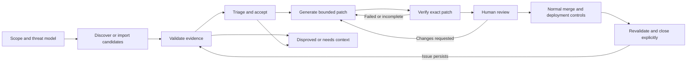

# Refactor OpenFix around the full security lifecycle

Read the [prioritized repository strategy](repo-strategy.md) for the current recommendation, code-specific gaps, implementation increments, and acceptance criteria. This document provides the supporting architecture contracts. The [exercise workbook](exercise-workbook.md) is the starting point for preparation.

## Current implementation

The current CLI normalizes SARIF/JSON, makes deterministic routing decisions from `policy.yaml`, invokes Cursor cloud remediation agents, and observes PR CI through `gh`. It has no complete model of candidate validation, accepted findings, patch identity, verification gaps, reviewer disposition, or explicit closure.

That implementation remains useful as a remediation adapter. The previous framing that all detection must come from deterministic scanners is too restrictive for a Codex Security integration: AI-assisted discovery and validation are themselves part of the documented product workflow.

## Proposed lifecycle

This is an application design, not a claim that every OpenAI surface uses one rigid sequence. Early triage can decide what to investigate before expensive validation. A later acceptance decision authorizes remediation.

## Contracts that need to change

| Concern | Current | Refactor |
| --- | --- | --- |
| Finding | Scanner record with severity | Candidate with provenance, asset/revision, evidence, and confidence |
| Validation | Implicit in incoming report | Confirmed, disproved, inconclusive, or not run; method and limitations |
| Triage | Fix/human/noise buckets | Owner, priority rationale, acceptance/defer/dismiss, and decision reason |
| Patch | Agent ID and PR URL | Exact base revision, changed files, artifact hash, scope, authoring engine |
| Verification | PR check polling | Original failure, legitimate behavior, test/rescan results, proof gaps, exact patch binding |
| Review | Expected downstream | Reviewer disposition bound to patch identity; changes invalidate approval |
| Closure | Not modeled | Separate explicit decision after verification and normal change controls |

## Architecture responsibilities

- **Adapters:** Codex Security discovery/validation and imported scanner findings. Cloud/runtime systems provide context through an explicit asset and version mapping; their mutations belong to separate authorized workflows.
- **Workflow domain:** state transitions, authorization checks, proof requirements, and invalidation. Vendor APIs do not own this policy.
- **Evidence store:** finding origin, source revision, commands, artifacts, results, coverage gaps, actor decisions, and retention.
- **Execution:** one isolated job per task, minimal credentials, controlled egress, resource bounds, and cancellation.
- **Review and publication:** a separate identity can publish a reviewed patch; branch protection and normal deployment controls retain authority.

## Existing standalone prototype

`src/lifecycle/workflow.mjs` implements the state and decision gates while preserving prior states and decision events. Its tests cover missing evidence, unvalidated findings, false positives, stale patch verification, approval invalidation, and premature closure. `scripts/demo-lifecycle.mjs` exercises the full decision sequence with explicitly simulated evidence. This module is not wired into the running `openfix` / `dev` CLI.

The prototype does not implement a production scan executor, a hosted multi-tenant service, live cloud/runtime connectors, or a GitHub publication service. A successful lifecycle demo is not a live Codex Security scan or security evaluation.

## Implementation sequence

1. Use the lifecycle domain as the record of truth and adapt SARIF imports into candidates.
2. Implement and verify the documented Codex Security CLI/SDK adapter using the customer's chosen supported authentication. Preserve completed-vs-covered and failed-vs-policy-exit distinctions.
3. Move Cursor remediation behind the same patch/evidence contract rather than keeping it as the top-level workflow.
4. Introduce isolated execution, external verification, audit storage, and actor identity before customer code is accepted.
5. Add a workbench over actual lifecycle state and artifacts. Show inconclusive validation, failed verification, and missing context as normal outcomes.
6. Add publication and closure with exact artifact binding, protected merge, rollout evidence, and revalidation.

## OpenAI alignment

OpenAI's scan guide separates scan completion from coverage, includes source-based validation, and asks reviewers to accept a finding before fixing it. Its fix guide separates patch generation, application, verification, and explicit closure. Runtime reproduction is valuable when feasible; missing runtime proof must be recorded rather than silently converted into certainty.

References: [scan guide](https://learn.chatgpt.com/docs/security/plugin/scans), [fix guide](https://learn.chatgpt.com/docs/security/plugin/fix-findings), [CLI contract](https://learn.chatgpt.com/docs/security/cli/reference), [SDK contract](https://learn.chatgpt.com/docs/security/sdk).
