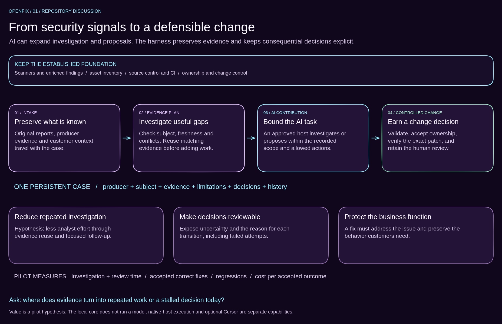
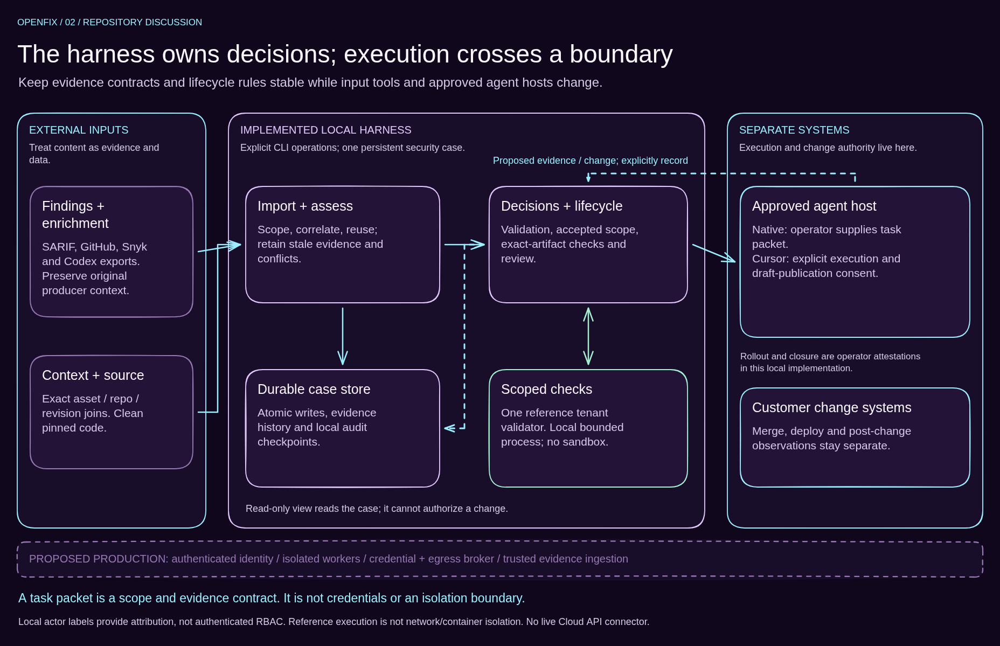
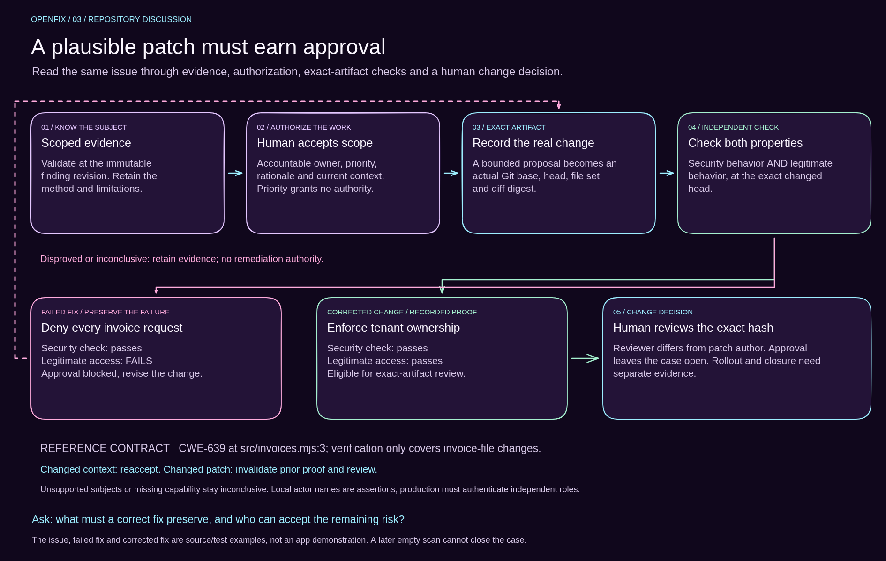

# OpenFix architecture whiteboards

Three editable Excalidraw views for explaining customer value, system boundaries and change decisions. Choose the view that helps answer the question in front of you. The diagrams support a repository conversation; no running application is needed.

The purple canvases use large text, grouped cards, connected arrows and clickable source links. Every shape and label is editable. Each scene is self-contained, with no embedded image or external font asset. PNG and SVG exports make them easy to browse directly on GitHub.

## 1. Customer workflow and value

[Editable Excalidraw](01-customer-value.excalidraw) · [SVG](01-customer-value.svg) · [PNG](01-customer-value.png)

**Explain:** preserve existing findings and enrichment, investigate the gaps that change a decision, and use an approved AI host for bounded work. Scanners, inventory, CI, ownership and change control remain the foundation.

- The value hypothesis is less repeated investigation and more reviewable decisions. Measure human effort and accepted correct outcomes before claiming improvement.
- Ask: “Where does evidence turn into repeated work or a stalled decision today?”

Read [the AI security model](../ai-security-model.md) and [import/enrichment implementation](../architecture.md#2-evidence-is-assessed-before-it-becomes-a-decision).

## 2. System and trust boundaries

[Editable Excalidraw](02-system-boundaries.excalidraw) · [SVG](02-system-boundaries.svg) · [PNG](02-system-boundaries.png)

**Explain:** evidence contracts and lifecycle rules remain stable while source adapters and approved agent hosts change. The local harness owns case decisions; native-host execution and customer change systems cross explicit boundaries.

- A task packet carries scope and evidence. It is not credentials, authorization or a sandbox.
- Local actor labels and bounded processes are reference controls. The dashed production strip identifies authenticated identity, isolated workers, credential/egress brokering and trusted evidence ingestion as future work.
- Ask: “Which execution host and data/action boundary can the customer approve?”

Read [the detailed component diagram and tradeoffs](../architecture.md#1-implemented-components-and-trust-boundaries), then inspect [operations](../../src/workflow/operations.mjs), [store](../../src/workflow/store.mjs) and [providers](../../src/workflow/providers.mjs).

## 3. Evidence, proof and approval

[Editable Excalidraw](03-proof-and-approval.excalidraw) · [SVG](03-proof-and-approval.svg) · [PNG](03-proof-and-approval.png)

**Explain:** a patch must preserve legitimate behavior as well as address the reported security issue. Denying every invoice request passes the security check but fails the business contract. The corrected tenant predicate earns review of its exact artifact.

- Changing the patch invalidates prior proof and review; changed context requires acceptance again. Inconclusive proof never becomes success.
- The installed reference profile covers only CWE-639 at `src/invoices.mjs:3` and invoice-file changes. Other cases need their own approved validation capability or reviewed evidence.
- Ask: “What must a correct fix preserve, and who can accept the remaining risk?”

Read [the lifecycle](../architecture.md#3-the-lifecycle-includes-failure-changing-context-and-invalidation), [verification code](../../src/workflow/validation.mjs) and [negative cases](../../tests/workflow.test.mjs). Approval leaves the case open; rollout and closure require separate evidence.

## Open and adapt a canvas

Download an `.excalidraw` file, open [Excalidraw](https://excalidraw.com), and choose **Menu → Open** to load it. Zoom to the relevant area. Cards and their labels are grouped; connected arrows follow the nodes. Boxes link to the corresponding repository files. Use a PNG or SVG when you only need a static visual.

For a discovery-led discussion, the [blank customer-workflow canvas](../prep/customer-workflow.excalidraw) remains available. Fill that canvas from the customer's answers rather than assuming the reference application matches their scenario.

## View in VS Code

**Excalidraw:** install [Excalidraw by pomdtr](https://marketplace.visualstudio.com/items?itemName=pomdtr.excalidraw-editor), the extension recommended by this workspace. Open `02-system-boundaries.excalidraw`. If an existing tab still displays JSON, run **Excalidraw: Open Excalidraw** from the Command Palette, or right-click its tab and choose **Reopen Editor With… → Excalidraw**. The workspace associates `.excalidraw` files with that visual editor.

**Mermaid:** open [architecture.md](../architecture.md), then run **Markdown: Open Preview to the Side** from the Command Palette, or press **Shift+Cmd+V** on macOS / **Ctrl+Shift+V** on Windows and Linux. The diagrams render inside the Markdown preview; standalone `.mmd` files are source definitions. [VS Code 1.121 and later include Mermaid support](https://code.visualstudio.com/updates/v1_121). For an older version or a fork without that feature, install [Markdown Preview Mermaid Support](https://marketplace.visualstudio.com/items?itemName=bierner.markdown-mermaid).

**Immediate previews:** open this README in Markdown preview to see all three PNG exports, or open a `.png` file directly. These static views require no Excalidraw extension. The native `.excalidraw` files provide editing and source links.

## Rebuild and verification

`python scripts/build-architecture-whiteboards.py` regenerates the three editable scenes using only Python's standard library. Export updated previews from Excalidraw as SVG and PNG after changing a scene. The checked-in previews were exported through the native Excalidraw 0.18.1 APIs.

All three scenes were opened in the native editor: 133 editable elements and 18 bound arrows in total. Native restore/export retained element IDs, reciprocal arrow bindings and all text tokens. A pointer-drag check confirmed that a connected arrow follows a moved node. No page errors were observed. These checks verify the diagram files, not security functionality.
